# Light Work

[](https://sriram-gona-01.github.io/light-work/)

**[Open the project page →](https://sriram-gona-01.github.io/light-work/)**

A harness for [Claude Code](https://code.claude.com/docs) that aims to cut the token cost of developing a feature without lowering quality. The main session stays on one model with a warm prompt cache, and other work goes to cheaper models through subagents that get just the context they need from files.

- **Main metric:** cost-weighted tokens per feature lifecycle (plan → build → test).
- **Guardrails:** tests pass on the first run, and the number of human corrections per feature.

> **Status:** MVP tooling is built and unit tested. No experiment has run yet, so there are no savings results to report. See [`docs/context/tasks.md`](docs/context/tasks.md).

## The five layers

| Layer | What it does |
|---|---|
| **Measure** | Reads Claude Code transcripts, deduplicates usage, and tags it by feature, phase, arm, and agent. |
| **Shrink** | `lw run` saves long command output to a file and prints a short summary. Headroom is an optional arm, currently blocked. |
| **Organize** | Lean `CLAUDE.md`, state files, brief and summary templates, a subagent roster, and a verification gate. |
| **Decide** | A break-even advisor that recommends staying, delegating, restarting, or compacting. It never switches models. |
| **Prove** | Arms from plain Claude Code to the full harness, an experiment protocol, and a report. |

## Quickstart

Needs [uv](https://docs.astral.sh/uv/) and Claude Code.

```bash
git clone https://github.com/sriram-gona-01/light-work.git
cd light-work
uv sync
uv run pytest
```

Fill in `pricing.yaml` from [Anthropic's pricing page](https://www.anthropic.com/pricing). Until you do, every report shows tokens but refuses to show costs.

```bash
uv run lw arm route                  # choose an arm, then start a fresh Claude Code session
uv run lw feature start F1           # tag work before your first prompt
uv run lw feature phase build        # move through plan, build, test
uv run lw usage --feature F1 --by agent
uv run lw advise                     # recommendation, with the numbers behind it
uv run lw run -- uv run pytest       # short summary; full output saved to a log
uv run lw feature end
uv run lw snapshot                   # keep usage after Claude Code cleans up transcripts
uv run lw report --features F1 --arms baseline,route
```

## Arms

| Arm | Adds |
|---|---|
| `baseline` | Logging only. No agents, behavior hooks, or routing rules. |
| `verify` | `test-runner`, `test-writer`, and the verification Stop gate. |
| `route` | `scout`, `implementer`, `reviewer`, and routing rules. |
| `offload` | Guidance to use `lw run` for long output. |
| `headroom` | Headroom compression. **Blocked** until subscription login is confirmed; see [`decisions.md`](docs/context/decisions.md). |

## Reproducing a result

Follow [`docs/experiments/protocol.md`](docs/experiments/protocol.md): the same features and starting commit for every arm, a fresh session per feature, and at least 3 runs per arm where possible. Record guardrails in `docs/context/tasks.md`, then run `lw report`.

## Privacy

Usage data stays on your machine in the gitignored `.lightwork/`. Hooks record sizes and names, never message content, and `results/` holds aggregates only. Check a report before you publish it.

## Layout

```
harness/         agent definitions, CLAUDE.md fragments, arms.yaml
src/lightwork/   the lw CLI and hook scripts
docs/            spec, context files, templates, experiment protocol
results/         shareable aggregates
site/            the project page, deployed to GitHub Pages
tests/           pytest suite with synthetic fixtures
```

Inspired by [Headroom](https://github.com/headroomlabs-ai/headroom).
